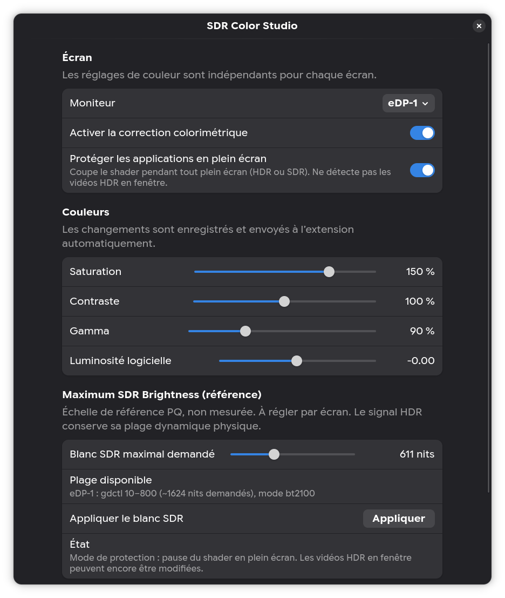

# SDR Color Studio — Guide rapide

[English / README principal](../README.md)

SDR Color Studio est une **extension GNOME 51** accompagnée d'une application **GTK4/libadwaita** pour ajuster saturation, contraste, gamma, luminosité logicielle et blanc SDR de référence écran par écran.



## Installation (Arch Linux)

```bash
sudo pacman -S --needed python-gobject gtk4 libadwaita glib2 ffmpeg mpv
./install.sh
```

Pour ouvrir les réglages dans GNOME Extensions :

```bash
gnome-extensions prefs sdr-color-studio@local
```

Ou la GUI indépendante : `~/.local/bin/sdr-color-studio`.

Si le bouton de préférences n'apparaît pas après une mise à jour, déconnecte-toi puis reconnecte-toi une fois : GNOME peut garder en mémoire l'ancienne configuration de l'extension.

## Langues

La sélection **Language / Langue** détecte la langue du système ou permet de choisir français, anglais, allemand, espagnol, italien et portugais (Brésil). **La traduction est encore partielle** dans les langues autres que le français : certains messages avancés restent en français ou en anglais. Les autres langues utilisent un repli en anglais.

## HDR : ce que le projet fait vraiment

- Le blanc SDR modifie une **référence PQ demandée à Mutter**, pas la puissance physique de l'écran mesurée en nits.
- Les corrections colorimétriques sont des effets logiciels expérimentaux, **pas une calibration**.
- La protection plein écran suspend le shader pour tout le bureau, mais **ne distingue pas** une vidéo HDR affichée dans une fenêtre.
- Les mires HDR10 incluses permettent une comparaison visuelle, **pas une mesure instrumentale**.

## Patch Mutter optionnel

Le patch peut augmenter la plage théorique de blanc SDR demandée sur Mutter 51.x. Il n'est pas nécessaire pour la GUI, et il n'est **jamais installé automatiquement** par le script de compilation.

```bash
sudo pacman -S --needed base-devel git python patch
./build-mutter.sh
# Seulement après vérification du paquet obtenu :
./install-patched-mutter.sh
```

Retour à Mutter officiel : `./restore-official.sh`, éventuellement depuis un TTY.

Pour les détails et la contribution, consulte le [README en anglais](../README.md), [CONTRIBUTING](../CONTRIBUTING.md) et [SECURITY](../SECURITY.md).
